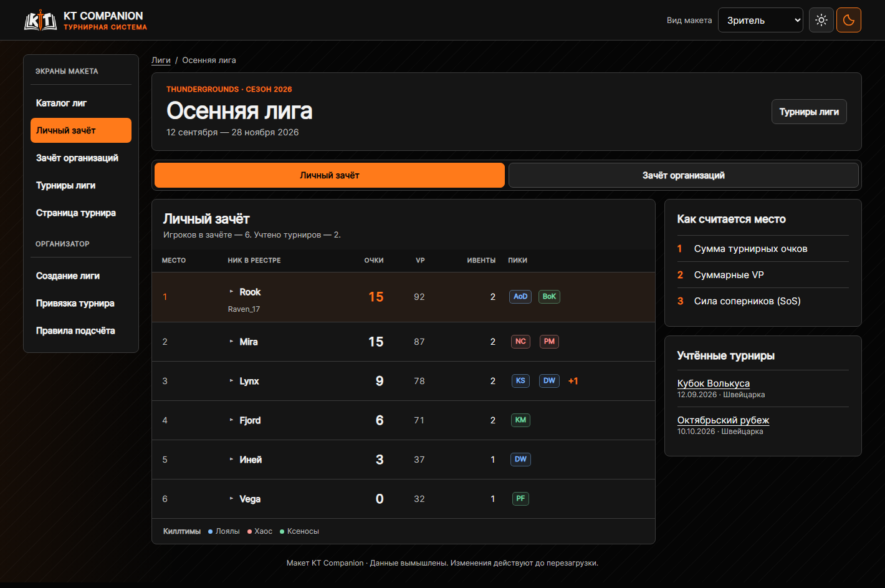

# План реализации лиг Kill Team

**Результат для игрока.** У каждой лиги своя публичная страница. Из турнира можно перейти в нужный зачёт и раскрыть строку, чтобы увидеть, откуда взялись место, очки и число ивентов. История следует за игроком из Реестра или за организацией при смене ников и составов.

**Результат для организатора.** При создании лиги можно сразу подключить прошедшие турниры. Для личного зачёта и зачёта организаций отдельно выбираются основные очки и тай-брейки.

[Кликабельные экраны](../../../design/leagues/index.html) · [Экраны, регламент и 48 сокращений киллтим](../specs/2026-11-19-leagues-design.md)

## Что проверить на макетах

| Сценарий | Ожидаемый результат | Экран |
| --- | --- | --- |
| Открыть Rook в личном зачёте | «Ворон» в сентябре и `Raven_17` в октябре. Одна строка, 2 ивента, `9 + 6 = 15 ТП`, пики AoD и BoK. | [Личный зачёт](../../../design/leagues/index.html#solo) |
| При равных 15 ТП сменить собственный порядок VP → SoS на порядок из «Кубка Волькуса» | По VP выигрывает Rook, `92 > 87`. По SoS выигрывает Mira, `25 > 21`. Турнир сохраняет опубликованные места. | [Настройка правил](../../../design/leagues/index.html#rules) |
| Раскрыть Fresh Meat | Парный состав принёс 8 очков, два состава в командном этапе принесли 10 и 6. Сумма **24**, ивентов **2**. | [Организации](../../../design/leagues/organizations.png) |
| Присоединить «Контрольную точку» | Прошедший турнир досчитан сразу. Появляется гость «Стриж» с 6 ТП и переход к сверке с Реестром. | [Привязка этапа](../../../design/leagues/index.html#attach) |
| Открыть лигу на телефоне, нажать ник или `+1` рядом с пиками | В узкой таблице доступны место, имя, очки, первый тай-брейк и ивенты. В раскрытии — сыгранные киллтимы с полными названиями. | [Телефон, светлая тема](../../../design/leagues/mobile.png) |
| Открыть итоги «Кубка Волькуса», затем «Итоги лиги» | Переход из официальных итогов этапа в личный зачёт той же лиги. Для парного или командного турнира открывается зачёт организаций. | [Страница турнира](../../../design/leagues/index.html#tournament) |

## Архитектура и источники

Лига принадлежит существующему сервису `tournaments`. PostgreSQL хранит регламент, связи с этапами и подтверждённые соответствия участников. Для первой версии таблица вычисляется по запросу пакетно из опубликованных источников и в одном согласованном снимке БД. Так привязка старого турнира, его исправление и отвязка используют один расчёт. На клиент приходит готовый рейтинг вместе с объяснением каждого вклада.

| Что уже есть | Что использовать |
| --- | --- |
| Аккаунт, турнирное имя и «Никнейм в Реестре» | `accounts.users.id`, `register_nickname`, `tournament_participants.user_id`, сохранённые стороны матча и `game_participants`. Для поиска подходит существующий поиск по `register_nickname`. В публичную модель передавать только нужные поля профиля. |
| Организация и заявленный состав | `player_teams.id` и `tournament_team_rosters.team_id`. Состав даёт исходный результат. Организация объединяет все свои составы, включая два на одном этапе. |
| Публикация турнира | `tournament.finalResults` и статус `completed`. Соло ссылается на `participantId`, команды — на `rosterId`. Отдельные матчи и составы дают пики, очные встречи, замены и недостающие расчётные значения. |
| Форматы, порядок и фракции | `src/domain/tournaments/{constants,input,results,standings}.js`, `src/domain/team-tournaments.js` и канонический словарь `src/domain/kill-teams.js`. |
| Интерфейс | Существующая оболочка турниров, `public/companion-tokens.css`, `public/companion-tabs.css`, компоненты каталога и словари `public/i18n/{ru,en}.js`. Страницы лиг поддерживают обе темы и прямые ссылки. |

## Последовательность разработки

### 1. Модель лиги и права доступа

- [ ] Создать миграцию `116_leagues.js` в `src/db/migrations/`, если номер ещё свободен при реализации, и зарегистрировать в `src/db/migrate.js`. Добавить `tournaments.leagues` (ID, уникальный slug, название, владелец, форматы, версия), `league_rules` (PK лиги и вида зачёта, основные очки, шкала, упорядоченные критерии, версия снимка источника), `league_tournaments` (PK лиги и турнира, обратный индекс по турниру). Удаление связи исключает вклад только из выбранной лиги. Один турнир может входить в несколько лиг.
- [ ] Для идентификации завести `league_people` с неизменяемым ID, опциональной ссылкой на аккаунт и реестровым именем для подтверждённой карточки без аккаунта. Частичный уникальный индекс на `(league_id,user_id)` для связанного профиля. `league_person_bindings` связывает стабильный ключ исходного выступления с карточкой. Хранить, кто и когда подтвердил или исправил соответствие. Постоянная карточка сохраняет историю после удаления аккаунта. Для команд идентификатором служит существующий `team_id`.
- [ ] Сохранять подтверждённого получателя места при замене в `league_place_recipients` с уникальным `(league_id, tournament_id, participant_id)` и внешним ключом на карточку в той же лиге. Сигнализировать о споре, когда за одним официальным местом обнаружено несколько фактических игроков. До подтверждения резервировать только очки за это место.
- [ ] Добавить в `src/domain/access.js` и `src/api/authorization.js` явные проверки `league.create` и `league.manage`. Предлагаемый доступ к созданию — `canCreateTournament`. Привязывать турниры, менять регламент и сверять личности могут владелец лиги и администратор платформы. Права судьи отдельного турнира ограничены этим турниром. Организатор лиги может привязать опубликованный доступный турнир из каталога. Публичное чтение отдаёт видимые ссылки и публичные поля.
- [ ] В репозитории `src/db/repositories/leagues.js` провести запись лиги, правил и выбранных связей одной транзакцией. Изменения существующей лиги — с проверкой ожидаемой `revision`. Повторная привязка того же турнира идемпотентна. Обновить выдачу прав роли `kt_tournaments` и её последовательностей по образцу `110_calendar_events.js` и настройки развёртывания ролей.

**Приёмка.** Создание соло-, парной, командной и смешанной лиги. Нельзя сохранить ноль форматов. Два одновременных добавления одного этапа дают одну связь. Зритель, организатор соседней лиги и судья этапа получают публичную модель и не могут изменить регламент.

### 2. Превратить опубликованный этап в проверяемые вклады

- [ ] В `src/domain/leagues/event-contributions.js` определить `buildEventContributions(eventBundle, bindings)` с выходом `contributions`, `encounters`, `issues` и `supportedMetrics`. У каждого вклада есть `tournamentId`, ключ первоисточника, вид субъекта, официальное место, исходные ТП, доступные метрики и пики. Вклад с нулевыми ТП допустим. Число ивентов определяется по различным `tournamentId`.
- [ ] Загружать опубликованные строки всех привязанных этапов пакетно. В соло читать фактическую личность через `matchParticipant`, снимки и связи `game_participants`. При замене различать стороны сыгранных матчей. В команде брать организацию состава на этапе и исторический состав игроков. Для пиков нормализовать названия через `canonicalKillTeam`, искать фактический выбор в сохранённом результате игры. Одиночную запасную заявку помечать «Заявлена», неизвестную фракцию показывать исходным текстом нейтрального цвета.
- [ ] Разделить «Ожидает итогов», «Учтён» и «Требует данных». У старого завершённого этапа можно восстановить недостающую числовую метрику из подтверждённых матчей по правилам **этого** формата. Официальные места брать из публикации. Если для выбранного режима отсутствует надёжный обязательный факт, весь этап получает «Требует данных» и временно даёт ноль вкладов. В ответе назвать поле и нужное действие. После исправления источника или правил следующий расчёт автоматически повторяет попытку. Остальные этапы продолжают считаться.
- [ ] При отсутствии связи с профилем создать устойчивое по первоисточнику временное представление, доступное для сверки. Гость включается автоматически. Повторное чтение не создаёт новых карточек. Написание реестрового или турнирного ника может подсказать кандидатов. Только достоверный ID или явное подтверждение соединяет истории. Доступный снаружи `GET` не создаёт записи в БД.
- [ ] При привязке архивного этапа, публикации и исправлении результатов выполнять идемпотентное обновление карточек и источников личности в транзакции записи. Точки интеграции — `src/api/tournaments.js` и `src/api/team-tournaments.js`, включая перепубликацию и перерасчёт. Агрегированные очки остаются вычисляемыми. При наличии `userId` повторно использовать карточку независимо от текста ника. Для неизвестной личности сохранять ключ исторической стороны и версию привязки. В заявке ещё идущего этапа новый участник виден по действующим правилам видимости турнира, очки лиги появляются при публикации.

**Приёмка.** Один профиль с двумя турнирными никами остаётся одной строкой. Два одноимённых гостя остаются различимыми. Исправление привязки переносит очки, счётчик и пики ровно один раз. Один человек, сыгравший за два клуба в разное время, оставляет каждый командный результат своему клубу на момент турнира.

### 3. Регламент и подсчёт

- [ ] В `src/domain/leagues/rules.js` реализовать `resolveTournamentOrder(tournament)` и `validateLeagueRules(rules, sources)`. Для WTC Doubles разворачивать его фиксированный порядок. Для остальных вариантов разрешать эффективный порядок турнира с учётом `null` и пустого списка. Задать каталог метрик с их смыслом и формулами. Сохранить независимую копию выбранного порядка по каждому зачёту. Показывать несовместимость до применения.
- [ ] В `src/domain/leagues/standings.js` реализовать `buildLeagueStandings(contributions, encounters, rules)`. Сначала переводить **каждое выступление** в основные очки, затем группировать по человеку или организации. Для суммы ТП складывать исходные ТП. Для мест читать официальное место состава или игрока и его значение в шкале, включая значение для всех последующих мест. Значения шкалы — целые, неотрицательные и невозрастающие. Шкала в примере `10 / 8 / 6 / 4 / 0`. Суммировать **все** составы на этапе. Возвращать список источников за каждой суммой.
- [ ] Для своих тай-брейков поддержать список критериев в заданном порядке. Доступны стандартные показатели и критерии уровня лиги. Расчёт очных встреч работает внутри ещё равной группы. Показатели SoS и усечённого Бухгольца сохраняют семантику исходных этапов. При полном равенстве присвоить общее место с пропуском следующего номера. Стабильный порядок отображения при этом не разделяет места.
- [ ] Определение собственного критерия хранить как `{name, metric, aggregate}`. Разрешённые операции `sum` и `max` применяются к значениям субъекта по этапам. Валидировать наличие фактической метрики, уникальность операции с показателем и порядок приоритетов. Пример «Лучшие VP за этап» даёт Rook `max(43,49) = 49`, Mira `max(45,42) = 45`. Для разных игроков одного соло-слота считать списки соперников и bye по правилам из спецификации.
- [ ] Поддержать отдельные `preview` и `save` с одним валидатором и калькулятором. При изменении состава форматов, привязок или правил `preview` показывает изменения по местам и источник ошибок. `save` атомарно применяет подтверждённую конфигурацию. Перепубликация результатов автоматически заменяет вклад этапа при следующем чтении.

**Приёмка.** На примере сезона получаются 15 ТП и 2 ивента у Rook, победа Mira при импорте другого порядка, 24 очка и 2 ивента Fresh Meat. Отвязка «Командного кубка» меняет Fresh Meat на 8 очков и 1 ивент. Повторная публикация тех же результатов сохраняет цифры.

### 4. API лиги и обратная связь из турнира

Добавить обработчики в `src/api/leagues.js`, подключить их через `src/api/routes-tournaments.js`. Параметры `leagueId`, `slug` и `tournamentId` имеют разные назначения. Уровень доступа определяется сервером.

| Предлагаемый маршрут | Контракт |
| --- | --- |
| `GET /api/leagues` и `GET /api/leagues/:slug` | Список и публичная карточка, форматы, регламент и статусы видимых этапов. |
| `GET /api/leagues/:slug/standings?track=solo\|org` | Готовые места и счётчики, основные очки, значения тай-брейков и коды пиков. При раскрытии строки запрашивать историю по её устойчивому ключу в том же зачёте. |
| `POST /api/leagues/preview` и `POST /api/leagues` | Предпросмотр создания и сохранение лиги вместе с источником импортированных правил и выбранными этапами. |
| `POST /api/leagues/:leagueId/preview` и `PATCH /api/leagues/:leagueId` | Предпросмотр и применение изменений настроек и состава этапов. Единственный путь записи конфигурации, включая привязку и отвязку. Конфликт `revision` возвращает 409 и предлагает загрузить актуальные настройки. |
| `PUT /api/leagues/:leagueId/bindings/:sourceKey` | Подтвердить профиль из Реестра, связать гостевую карточку с аккаунтом или исправить связь. Операция идемпотентна и ограничена одной лигой. |
| `PUT /api/leagues/:leagueId/places/:tournamentId/:participantId` | Организатор выбирает получателя единственной награды за место среди фактических игроков этого слота. Повторный выбор заменяет прежнее решение с записью в аудит. |
| `GET /api/leagues/:slug/standings/:subjectKey?track=…` | Вклады по турнирам, исторические имена, составы, очки и полные названия киллтим выбранного субъекта. Служебные кандидаты для сверки доступны отдельным запросом организатора. |

- [ ] Добавить к публичной и управленческой модели одного турнира `leagues: [{slug,name,track}]`. Фильтровать видимость до сериализации. Служебные варианты сопоставления и аудит доступны только организатору и администратору.
- [ ] Для сверки предусмотреть `GET /api/leagues/:leagueId/bindings?status=pending&q=…` с `league.manage`. Возвращать только кандидатов и источник выбранной спорной записи. Служебные ответы пометить `private, no-store`.

**Приёмка.** Прямая ссылка возвращает правильный зачёт гостю, а организатору — его доступные действия. Одна ссылка на турнир отражается на обеих страницах. После отвязки последней лиги кнопка исчезает.

### 5. Публичные страницы и инструменты организатора

- [ ] Подключить `/leagues`, `/leagues/:slug` и глубокие ссылки `?track=solo` / `?track=org` в `src/http/static.js`, `src/services/catalog.js` и клиентскую навигацию `public/app.js`. Выделить экраны в `public/tournament-leagues.js` и стили в `public/tournament-leagues.css`. Обеспечить прямой вход гостя, обновление страницы и корректную кнопку браузера «Назад». В раздел «Турниры» добавить вход «Лиги».
- [ ] Собрать каталог, публичные зачёты, раскрытие участника или организации, список этапов и мастер «Название и форматы → Турниры → Правила». Предпросмотр использует серверную логику. Пользователь может добавить источник тай-брейков сразу при создании. Экран сверки показывает турнир, имя при выступлении, найденные карточки и эффект подтверждения.
- [ ] Добавить метаданные 48 киллтим из спецификации к каноническому словарю, выдавать из сервиса каноническое имя, код и сторону. В строке показывать две метки и `+N`. В раскрытии дать игры или этапы и полные названия. На мобильном экране сохранить читаемость места, очков, тай-брейка и числа ивентов. Поддержать клавиатуру, фокус после закрытия деталей, обе темы и RU/EN.
- [ ] В `public/app.js` встроить «Итоги лиги» в общие действия публичной страницы турнира и в режим управления той же страницей. Ноль связей скрывает действие, одна открывает нужный зачёт, несколько дают выбор лиги. В пустой лиге показывать понятное состояние, при ошибке загрузки — «Повторить». После успешной записи обновлять список этапов, таблицу и кнопку турнира.

**Приёмка.** Гость проходит «турнир → итоги лиги → выступления игрока → турнир». Организатор проходит «создать → привязать архив → импортировать или задать правила → проверить новые строки». Для обычного игрока открывается публичный вид.

### 6. Проверки и критерий готовности

- [ ] Для каждого реального игрока соло, пары и команды применяется обычный автоматический личный челлендж по зачётным играм. Проверить, что включение турнира в одну или две лиги и повторный пересчёт не выдают повторных начислений. Существующий трек использует подтверждённые игры связанного профиля.
- [ ] Предусмотреть модульные сценарии в `test/unit/tournament-leagues.test.js` и интеграционные в `test/integration/tournament-leagues.test.js`. Для UI использовать отдельный `test/unit/client-tournament-leagues.test.js`. Матрица охватывает смену ника, совпадающие реестровые строки, замены с bye, нулевой результат, одновременные привязки, старые финальные строки, перепубликацию, скрытые данные, SoS разных типов, общий ранг и фактически сыгранные пики.
- [ ] В GitHub Actions проверить запуск соответствующих тестов и общих проверок для **текущего SHA**. Интеграционный сценарий использует выделенный PostgreSQL с реальными сервисными ролями. По правилам проекта автоматические тесты выполняются в CI.
- [ ] Визуально пройти путь на десктопе и телефоне с длинными именами, с несколькими лигами у турнира, в обеих темах и языках. Проверить выбор фракции касанием, возврат из настроек и исправление ошибки сверки. Для будущего запуска **самого приложения** под тестирование подготовить локального администратора через действующий порядок `AGENTS.md`.

Функция готова к приёмке, когда примеры из первой таблицы воспроизводятся через обычные страницы, CI прошёл для проверяемого коммита и участник может объяснить каждое число в своей строке по учтённым турнирам.
